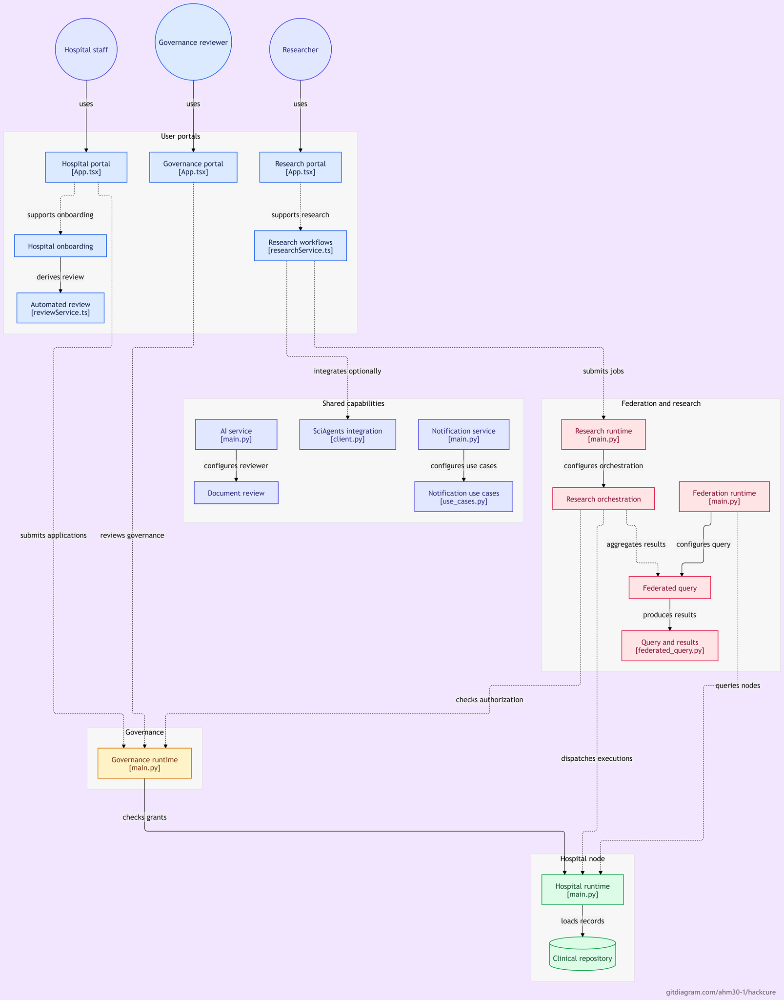

# MedOS — federated healthcare data and intelligence ecosystem

## What this repository is

MedOS connects hospitals, patients, clinicians, researchers, and an independent Governance / Ethics Authority without building one central clinical database. Each hospital keeps its clinical data in its own Hospital Node; access is granted explicitly (who, what, why, for how long); research follows Compute-to-Data; AI assists accountable humans. It integrates existing hospital systems (DMI/HIS) rather than replacing them.

*The target architecture, as described in the [product vision](docs/product/FEDERATED_HEALTHCARE_ECOSYSTEM.md): data stays in the hospitals, governance, consent, and audit apply to every access, and computation goes to the data.*

MedOS was built during a two-day hackathon. Every component below exists in code; the [current status](docs/CURRENT_STATUS.md) details each capability.

Before coding, follow the [agent startup checklist](docs/AGENT_STARTUP_CHECKLIST.md).

## Components

Depth: D1 interactive product, D2 functional integration, D3 distributed integration, D4 production or security depth (see the [glossary](docs/GLOSSARY.md)).

| Component | Path | Stack | Status | Local port |
|---|---|---|---|---|
| Hospital Node | [`instances/hospital-node/`](instances/hospital-node/README.md) | Python, FastAPI, Docker image | IMPLEMENTED D2–D4 | 8101, 8102, 8104 (one per hospital) |
| Governance Node | [`instances/governance-node/`](instances/governance-node/README.md) | Python, FastAPI | IMPLEMENTED D2–D4 | 8200 |
| Federation Service | [`services/federation/`](services/federation/README.md) | Python, FastAPI | IMPLEMENTED D2/D3 | 8300 |
| Research Service | [`services/research/`](services/research/README.md) | Python, FastAPI | IMPLEMENTED D3/D4 | 8400 |
| AI Services | [`services/ai/`](services/ai/README.md) | Python, FastAPI; Claude, Ollama fallback | IMPLEMENTED D3; advisory, clinician-reviewed | 8600 |
| Notification Service | [`services/notifications/`](services/notifications/README.md) | Python, FastAPI; UnifiedPush | IMPLEMENTED D2/D3 | 8700 |
| SciAgents integration | [`integrations/sciagents/`](integrations/sciagents/README.md) | Python, FastAPI | IMPLEMENTED D2; SciAgents itself is external | 8800 |
| MedOS landing and hospital onboarding | [`apps/web/landing/`](apps/web/landing/README.md) | React, TypeScript, Vite | IMPLEMENTED D1 | 5173 |
| Governance Portal | [`apps/web/governance-portal/`](apps/web/governance-portal/README.md) | React, TypeScript, Vite | IMPLEMENTED D1 | 5174 |
| Research Portal | [`apps/web/research-portal/`](apps/web/research-portal/README.md) | React, TypeScript, Vite | IMPLEMENTED D1; SciAgents connection D2 | 5175 |
| Hospital Portal (staff and patient administration) | [`apps/web/hospital-portal/`](apps/web/hospital-portal/README.md) | React, TypeScript, Vite | IMPLEMENTED D1 | 5176 |
| Patient App | [`apps/mobile/patient/`](apps/mobile/patient/README.md) | Flutter, Android | IMPLEMENTED D1 | — |
| Clinician App | [`apps/mobile/clinician/`](apps/mobile/clinician/README.md) | Flutter, Android | IMPLEMENTED D1 | — |
| Web design system | [`design-system/`](design-system/README.md) | React, Tailwind CSS v4 | IMPLEMENTED D1 | — |
| Communication contracts | [`contracts/`](contracts/README.md) | OpenAPI 3.1 | IMPLEMENTED, checked by [contract tests](tests/README.md) | — |
| Canonical dataset | [`demo-data/`](demo-data/README.md) | JSON, integrity checker | IMPLEMENTED | — |
| Hospital Node packaging | [`infrastructure/`](infrastructure/README.md) | Docker, Compose | IMPLEMENTED D3 | — |

The backends talk to each other over HTTP through the versioned contracts.

## Product and architecture

The [canonical product vision](docs/product/FEDERATED_HEALTHCARE_ECOSYSTEM.md) defines scope; the [technical architecture](docs/architecture.md) defines boundaries. CONFIRMED invariants:

- Federated: clinical source data stays under each Hospital Node's control; no central clinical database or cross-component SQL.
- Each hospital's DMI Adapter lives inside its own Hospital Node; no central service connects to every DMI.
- The Governance Node owns authorization and policy; the company operating the software is not the Governance / Ethics Authority.
- The Patient and Clinician Apps consume authorized views and never access hospital databases.
- Research uses Compute-to-Data: only controlled, aggregated results leave a node.
- AI is advisory and clinician-reviewed; medication warnings come from deterministic rules or validated sources, never from an LLM alone.
- SciAgents is external and integrated, not rebuilt.
- The optional ledger stores minimized proofs, never medical records.
- Clean / Hexagonal Architecture in every backend; components communicate through the versioned contracts in [`contracts/`](contracts/README.md).

Technical choices are recorded as [ADRs](docs/decisions/README.md).

*How the code is wired, generated from the repository with [GitDiagram](https://gitdiagram.com/ahm30-1/hackcure). Its "Hospital portal" box is the onboarding journey, now in `apps/web/landing/`; the Patient and Clinician Apps are not shown.*

## Running things

Each component's README gives its exact commands. In short:

- Python runtimes: from the component directory, `python3 -m venv .venv`, activate it, `pip install -r requirements-dev.txt`, then `python main.py` and `pytest`. The Hospital Node needs `HOSPITAL_NODE_CONFIG`, for example `config/hospital-a.demo.json`.
- Web apps: `npm install` in [`design-system/`](design-system/README.md) once, then `npm install`, `npm run dev`, and `npm test` in the app.
- Mobile apps: `flutter pub get`, `flutter test`, and `flutter run` on an Android emulator.
- Hospital Node in Docker: see its [container section](instances/hospital-node/README.md#container-hc-220).
- Scenario and identities: [scenario](docs/planning/demo-scenario.md).

CI runs tests and lint for AI Services, the Federation Service, the contract tests, and the Hospital Node package builder; other suites run locally.

## Repository map

- `apps/`: web (landing and onboarding, Hospital Portal, Governance Portal, Research Portal) and mobile (Patient App, Clinician App) products.
- `instances/`: Hospital Node and Governance Node, the autonomous trust boundaries.
- `services/`: AI, Federation, Notification, and Research capabilities.
- `integrations/`: SciAgents and future company/platform integrations.
- `contracts/`: versioned API, event, and Federation definitions.
- `design-system/`: web design tokens and React components shared by the web apps.
- `demo-data/`: canonical dataset reused by every product.
- `infrastructure/`, `production/`, `iot/`: environment-specific or optional technical assets.
- `docs/`: product truth, architecture, status, planning, ADRs, security, and research notes.
- `tests/`: cross-system contract tests.

## Documentation map

- [Documentation index, source hierarchy, and status vocabulary](docs/README.md)
- [Canonical product vision](docs/product/FEDERATED_HEALTHCARE_ECOSYSTEM.md)
- [Technical architecture](docs/architecture.md)
- [Current implementation status](docs/CURRENT_STATUS.md)
- [Open questions](docs/OPEN_QUESTIONS.md)
- [Architecture decisions](docs/decisions/README.md)
- [Security audit and threat model](docs/security/threat-model.md)
- [Planning backlog](docs/planning/backlog.md) and [scenario](docs/planning/demo-scenario.md)
- [Glossary](docs/GLOSSARY.md)

## Contributing

Work goes from a Ready issue through a branch, implementation, tests, review, and validation; see [CONTRIBUTING.md](CONTRIBUTING.md). Read [AGENTS.md](AGENTS.md) before changing the repository. Do not commit, push, deploy, or modify remote resources without authorization. Never commit secrets, credentials, or real patient data.
