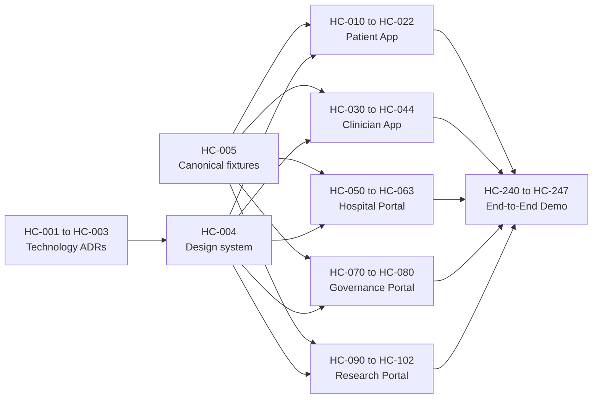
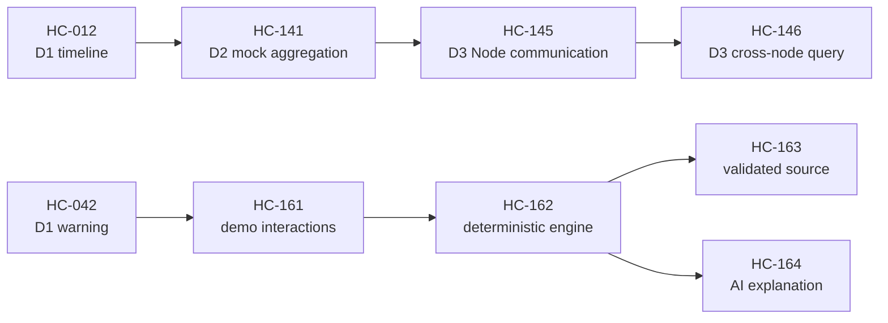
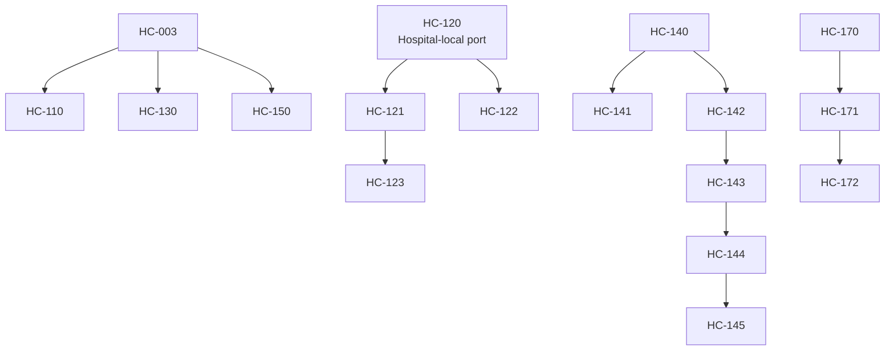
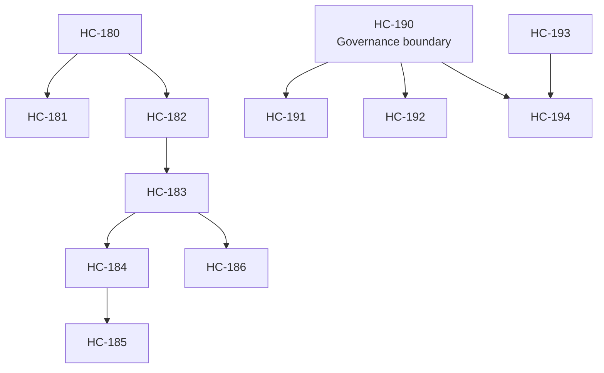

# Dependency Map

Real `Blocked by` and `Blocks` references live in the GitHub issues linked from [the backlog](backlog.md). These diagrams retain stable HC IDs. Arrows mean “unlocks or materially informs,” not a runtime import dependency.

## Demo-first delivery

## Patient and clinician upgrade paths

## Runtime and integration boundaries

## Compute-to-Data and immutable audit

The DMI Adapter remains inside each Hospital Node; the ledger remains inside Governance and excludes raw clinical data; SciAgents remains external; and visual D1 tickets do not depend on D3/D4 infrastructure.
