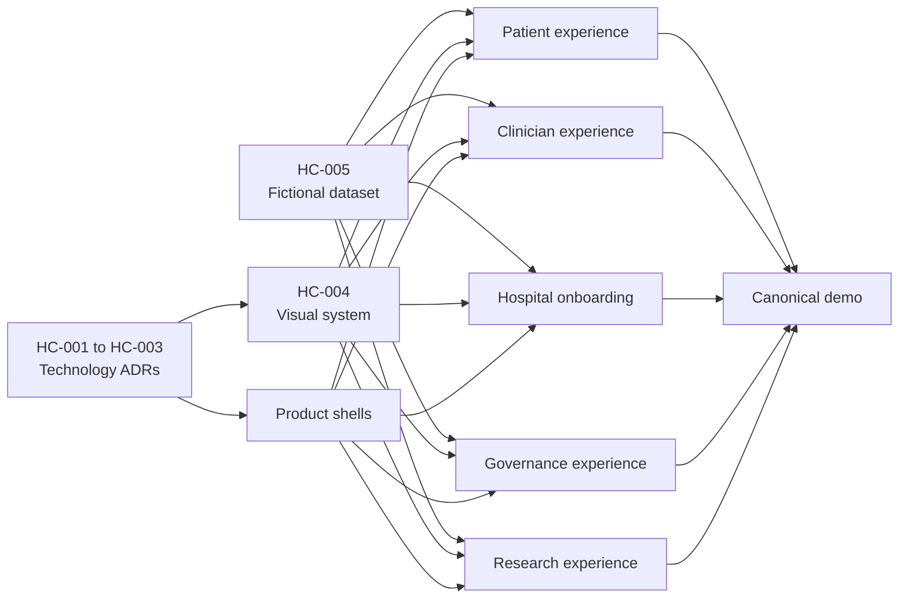
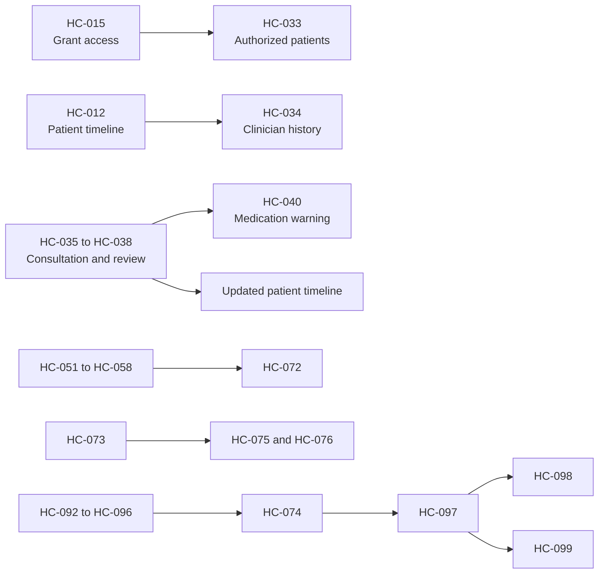
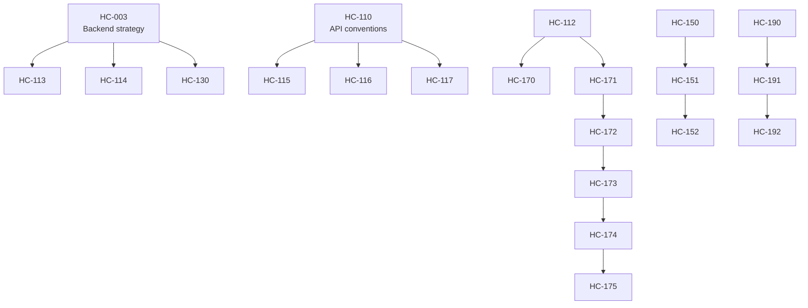
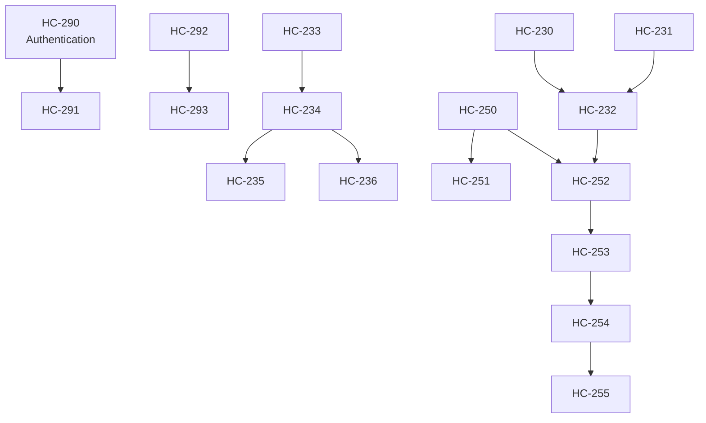

# Dependency Map

The backlog is intentionally front-loaded toward visible value. Arrows mean “unlocks or materially informs,” not a runtime import dependency.

## Demo-first delivery

## Cross-product demo state

## Contract and runtime dependencies

## Governance, ledger, and compute-to-data

The real ledger adapter never precedes `AuditLedgerPort`; research execution never bypasses governance authorization; and no dependency permits direct access to another component's persistence.
