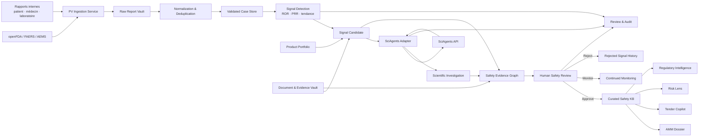
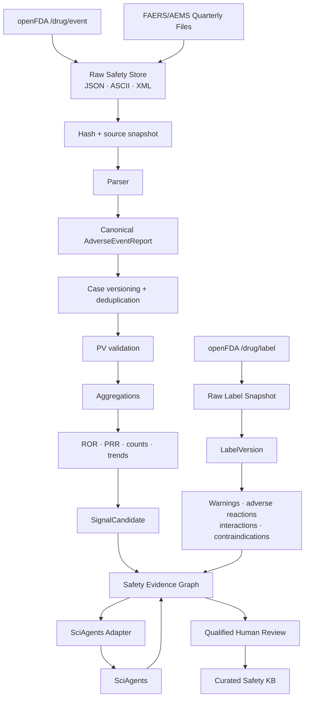

## Décision d’architecture

SciAgents doit rester un **moteur scientifique spécialisé**. Il ne doit pas gérer les rapports FAERS, calculer le ROR/PRR, maintenir le dossier AMM ou décider qu’un signal est confirmé.

```text
PharmaRegOps
→ détecte et structure le signal

SciAgents
→ cherche une explication mécanistique et documentaire

Reviewer pharmacovigilance
→ prend la décision

Safety Knowledge Base
→ conserve uniquement les connaissances validées
```

Le rapport de Phase 1 décrit déjà cette séparation : le moteur PV calcule le signal candidat, SciAgents fournit les mécanismes, contradictions et preuves, puis la mise à jour de la connaissance de sécurité reste soumise à une validation experte. fileciteturn0file4

# 1. À quoi sert exactement SciAgents ?

SciAgents répond à une question scientifique de ce type :

> Existe-t-il une relation biomédicale plausible entre le médicament X et la maladie ou l’événement Y, et quelles preuves soutiennent ou contredisent cette relation ?

Exemples :

```text
Metformin ↔ Type 2 Diabetes
Drug X ↔ Hepatic injury
Drug Y ↔ QT prolongation
Drug Z ↔ Renal failure
```

Il exécute ensuite :

```text
Résolution des deux concepts
→ recherche dans Hetionet
→ calcul DWPC
→ décomposition par métachemins
→ Ontologist
→ Proposer
→ Expander
→ Critic
→ recherche bibliographique
→ évaluation et audit
```

Hetionet reste le **graphe mécanistique de référence**. Le graphe `biokg`, construit depuis la littérature, est utilisé comme oracle de nouveauté et non comme moteur principal du raisonnement. fileciteturn0file6

# 2. Input actuel de SciAgents

L’API réellement disponible accepte actuellement un input minimal.

```http
POST /hypotheses
X-API-Key: <service-key>
Content-Type: application/json
```

```json
{
  "keywords": [
    "Drug X",
    "Hepatic injury"
  ],
  "mode": "sequential",
  "max_iterations": 3,
  "human_review": false
}
```

Pour obtenir la progression :

```http
POST /hypotheses/stream
Accept: text/event-stream
X-API-Key: <service-key>
```

Pour récupérer le résultat complet :

```http
GET /hypotheses/{run_id}
X-API-Key: <service-key>
```

SciAgents propose également la reprise d’un run suspendu, les rapports batch, l’ingestion de documents dans `biokg`, les workspaces scientifiques, le graphe propre à un workspace et l’export PDF. fileciteturn0file0

# 3. Input métier recommandé dans PharmaRegOps

Le frontend ne doit pas envoyer directement le format SciAgents. Il doit utiliser un contrat pharmacovigilance plus riche.

```http
POST /api/v1/pv/signals/{signal_id}/investigations
Authorization: Bearer <JWT>
Idempotency-Key: <uuid>
X-Correlation-ID: <uuid>
```

```json
{
  "drug": {
    "product_id": "product-17",
    "reported_name": "Drug X",
    "active_substance": "Substance X",
    "normalized_ids": {
      "chebi": "CHEBI:12345",
      "drugbank": "DB00000"
    }
  },
  "adverse_event": {
    "reported_term": "serious liver problem",
    "normalized_term": "Hepatic injury",
    "meddra_code": "10019805"
  },
  "signal_summary": {
    "unique_cases": 45,
    "serious_cases": 12,
    "ror": 3.4,
    "prr": 2.9,
    "median_onset_days": 9,
    "positive_dechallenge_cases": 7,
    "common_concomitant_drugs": [
      "Drug Y"
    ]
  },
  "evidence_refs": [
    "label-version-8",
    "literature-article-19",
    "case-cluster-4"
  ],
  "questions": [
    "Which mechanisms could support the association?",
    "Which evidence contradicts it?",
    "Which confounding factors require review?"
  ]
}
```

Le `SciAgentsAdapter` extrait pour l’API actuelle :

```json
{
  "keywords": [
    "Drug X",
    "Hepatic injury"
  ],
  "mode": "sequential",
  "max_iterations": 3,
  "human_review": false
}
```

Le contexte statistique reste conservé dans PharmaRegOps et est affiché avec le résultat SciAgents.

## Limite actuelle

SciAgents n’accepte pas encore directement :

- le ROR ;
- le PRR ;
- les cas agrégés ;
- les documents sélectionnés ;
- les contraintes de l’investigation ;
- les facteurs de confusion structurés.

Il faut donc distinguer deux versions.

### MVP

```text
Drug + adverse event
→ SciAgents
```

### Version suivante

Ajouter un endpoint :

```http
POST /hypotheses/contextual
```

avec :

```json
{
  "keywords": ["Drug X", "Hepatic injury"],
  "context_bundle": {
    "signal_statistics": {},
    "selected_evidence": [],
    "known_confounders": [],
    "questions": []
  }
}
```

Aucune donnée patient directement identifiable ne doit être envoyée à SciAgents.

# 4. Output de SciAgents

Le premier `POST /hypotheses` retourne un résumé :

```json
{
  "run_id": "run-sci-92",
  "keywords": [
    "Drug X",
    "Hepatic injury"
  ],
  "surfaced": true,
  "accepted": true,
  "awaiting_human": false,
  "stop_reason": "passed",
  "grounding_passed": true,
  "passed_quality_gate": true,
  "overall": 8,
  "cost_usd": 0.004
}
```

Le `GET /hypotheses/{run_id}` retourne le résultat scientifique complet :

- concepts Hetionet résolus ;
- score mécanistique ;
- métachemins ;
- contribution de chaque métachemin ;
- chemins biomédicaux ;
- hypothèse proposée ;
- développement de l’hypothèse ;
- critique ;
- arguments favorables ;
- contradictions ;
- citations ;
- score de grounding ;
- analyse de nouveauté ;
- qualité ;
- historique des agents ;
- coût ;
- audit du run. fileciteturn0file0

PharmaRegOps doit normaliser cette réponse.

```json
{
  "investigation_id": "investigation-31",
  "signal_id": "signal-14",
  "sciagents_run_id": "run-sci-92",
  "status": "awaiting_human_review",
  "concept_resolution": {
    "drug": {},
    "event": {}
  },
  "mechanistic_score": 0.71,
  "metapath_contributions": [],
  "graph_paths": [],
  "supporting_evidence": [],
  "contradicting_evidence": [],
  "critic_assessment": {},
  "confounders_to_review": [],
  "limitations": [],
  "grounding_passed": true,
  "quality_gate_passed": true,
  "engine_version": "sciagents-version",
  "graph_version": "hetionet-v1.0"
}
```

# 5. Interaction avec les autres services



## Interactions détaillées

| Producteur | Entrée du service | Sortie |
|---|---|---|
| Product Portfolio | Produit et substance normalisés | `product_id`, noms et identifiants |
| PV Intake | Rapport patient, médecin ou import | Rapport brut immuable |
| PV Normalizer | Rapport brut | Cas normalisé |
| Duplicate Service | Cas normalisés | Cas uniques et clusters |
| Signal Engine | Cas validés | ROR, PRR, tendance, signal candidat |
| Document Vault | Labels, articles, rapports | Versions et preuves |
| SciAgents Adapter | Médicament + événement | Investigation scientifique |
| Review Service | Signal + statistiques + investigation | Approve, monitor ou reject |
| Safety KB | Décision approuvée | Connaissance versionnée |
| AMM | Nouvelle connaissance | Variation, RCP ou notice à revoir |
| Tender | Nouvelle version sécurité | Preuve invalidée ou recalculée |
| Risk Lens | Tous les événements | Risques patient, réglementaire et commercial |
| Audit | Tous les appels et décisions | Traçabilité complète |

# 6. Les quatre graphes à ne pas confondre

## A. Hetionet — Reference Mechanism Graph

Contient des relations biomédicales de référence :

```text
Drug
Gene
Disease
Pathway
Anatomy
Side effect
Pharmacologic class
```

Il sert à répondre :

> Quels chemins biomédicaux peuvent relier le médicament et l’événement ?

Ne pas modifier Hetionet avec les rapports FAERS du projet.

```text
FAERS report
✗ ne devient pas une nouvelle arête Hetionet
```

Un rapport spontané n’est pas une vérité mécanistique.

## B. `biokg` — Literature Novelty Graph

Il est construit à partir de publications et de notes scientifiques.

Il sert à répondre :

> Cette association ou ce mécanisme est-il déjà présent dans notre corpus ?

L’endpoint suivant alimente ce graphe :

```http
POST /kg/ingest
```

Il ne met pas à jour Hetionet. fileciteturn0file0

## C. Safety Evidence Graph

C’est le nouveau graphe que PharmaRegOps doit construire.

Il contient les observations et preuves de sécurité :

```text
Product
Active substance
Adverse event
Case
Case cluster
Signal candidate
Signal statistic
Label version
Article
SciAgents investigation
Mechanism hypothesis
Review decision
Regulatory action
```

Il répond à :

> Pourquoi ce signal existe-t-il, quelles preuves le soutiennent, quelles preuves le contredisent et quelle décision a été prise ?

## D. Regulatory Dependency Graph ou Context Graph

Il contient l’état opérationnel :

```text
Product
Market
Authority
Requirement
Document version
Dossier
Tender
Risk
Review
```

Il répond à :

> Si cette connaissance de sécurité change, quels produits, dossiers, documents et appels d’offres sont affectés ?

# 7. Safety Graph versus Safety Knowledge Base

Cette distinction est essentielle.

## Safety Evidence Graph

Il peut contenir des informations non confirmées :

```text
signal candidat
association statistique
hypothèse SciAgents
article favorable
article contradictoire
facteur de confusion
review pending
```

## Safety Knowledge Base

Elle contient uniquement ce qui a été validé :

```text
relation de sécurité approuvée
niveau de preuve
décision humaine
date d’effet
produits concernés
actions réglementaires
version
```

```text
Safety Graph
→ large, exploratoire, contient l’incertitude

Safety KB
→ petite, curée, contrôlée et exploitable
```

Un signal candidat ne passe dans la Safety KB qu’après une décision humaine.

# 8. Modèle du Safety Graph

## Nœuds

```text
Product
ActiveSubstance
AdverseEventTerm
Report
CaseVersion
CaseCluster
SignalCandidate
SignalMetric
DrugLabel
LabelVersion
LiteratureDocument
MechanismHypothesis
Gene
Pathway
SciAgentsRun
ReviewDecision
SafetyKnowledge
RegulatoryAction
```

## Relations

```text
Product CONTAINS ActiveSubstance
Report MENTIONS Product
Report REPORTS AdverseEventTerm
CaseVersion VERSION_OF Case
CaseCluster GROUPS Case
SignalCandidate CONCERNS Product
SignalCandidate CONCERNS AdverseEventTerm
SignalCandidate COMPUTED_FROM CaseCluster
SignalCandidate HAS_METRIC SignalMetric
DrugLabel DESCRIBES Product
LabelVersion VERSION_OF DrugLabel
LabelVersion MENTIONS AdverseEventTerm
LiteratureDocument SUPPORTS MechanismHypothesis
LiteratureDocument CONTRADICTS MechanismHypothesis
SciAgentsRun PROPOSES MechanismHypothesis
MechanismHypothesis USES_PATH Pathway
ReviewDecision REVIEWS SignalCandidate
ReviewDecision APPROVES SafetyKnowledge
SafetyKnowledge REQUIRES RegulatoryAction
```

Chaque relation doit contenir :

```json
{
  "edge_id": "edge-72",
  "source_id": "signal-14",
  "predicate": "SUPPORTED_BY",
  "target_id": "article-19",
  "status": "candidate",
  "support_count": 1,
  "confidence": 0.74,
  "provenance": [
    {
      "document_id": "article-19",
      "version_id": "version-2",
      "fragment_id": "fragment-8"
    }
  ],
  "created_by": "sciagents",
  "review_status": "pending"
}
```

# 9. Faut-il mettre openFDA et FAERS dans le Knowledge Graph ?

## Réponse précise

### openFDA Drug Label

**Oui**, mais dans le Document Vault et le Safety Graph, pas directement dans Hetionet.

Le Drug Label API vient des fichiers Structured Product Labeling. Les labels sont des documents vivants contenant notamment indications, contre-indications, interactions et effets indésirables. L’API indique actuellement une actualisation hebdomadaire. citeturn603912search3

Pipeline :

```text
openFDA /drug/label
→ snapshot JSON
→ Document Vault
→ LabelVersion
→ extraction des sections de sécurité
→ Safety Graph
```

Exemple :

```text
LabelVersion-7
→ HAS_ADVERSE_REACTION
→ Hepatic injury

LabelVersion-7
→ HAS_WARNING
→ Liver function monitoring
```

Ces relations doivent porter la source, le `spl_set_id`, le `spl_id`, la date et la version.

### openFDA Drug Event / FAERS

**Non**, pas sous forme de milliers de documents envoyés à `/kg/ingest`.

Les rapports FAERS sont :

- incomplets ;
- parfois dupliqués ;
- non vérifiés ;
- influencés par le niveau d’utilisation et la médiatisation ;
- impropres à l’estimation de l’incidence ;
- insuffisants pour établir une causalité. citeturn603912search2turn603912search6

Ils doivent suivre ce pipeline :

```text
FAERS/openFDA event
→ rapport brut
→ normalisation
→ déduplication
→ cas versionné
→ agrégation
→ mesure statistique
→ signal candidat
→ Safety Graph
```

Le Safety Graph doit recevoir les **cas normalisés, clusters, statistiques et signaux**, pas des arêtes causales affirmant :

```text
Drug X CAUSES Hepatic injury
```

Relation correcte :

```text
SignalCandidate-14
OBSERVES_DISPROPORTION
Drug X × Hepatic injury
```

Relation incorrecte :

```text
Drug X CAUSES Hepatic injury
```

# 10. Pourquoi ne pas envoyer FAERS à `/kg/ingest` ?

`POST /kg/ingest` alimente le graphe `biokg`, utilisé comme oracle de nouveauté scientifique. Il attend des documents contenant titre, résumé, corps, auteurs, année et identifiants bibliographiques. fileciteturn0file0

Un rapport FAERS :

- n’est pas un article ;
- ne contient généralement pas un texte scientifique complet ;
- ne représente pas une relation validée ;
- peut être un doublon ;
- peut contenir un produit concomitant responsable ;
- pourrait contaminer l’évaluation de nouveauté.

Exemple de contamination :

```text
Plusieurs rapports FAERS mentionnent Drug X et hepatic injury
        ↓
biokg considère leur cooccurrence comme déjà connue
        ↓
NoveltyChecker retourne « mécanisme connu »
```

Cette conclusion serait méthodologiquement incorrecte.

# 11. Où mettre chaque source openFDA ?

| Source | Destination correcte |
|---|---|
| `/drug/event` | Raw Report Vault puis PV pipeline |
| FAERS/AEMS fichiers trimestriels | Data lake PV et benchmark reproductible |
| `/drug/label` | Document Vault, versioning et Safety Graph |
| `/drug/enforcement` | Regulatory Intelligence, Risk Lens et Product Portfolio |
| Drugs@FDA | Product Portfolio et autorisations |
| NDC Directory | Résolution et normalisation produit |
| Orange Book | Product Portfolio et références réglementaires |

openFDA expose séparément événements indésirables, labels, rappels, Drugs@FDA, NDC, Orange Book et pénuries. Ces sources ne doivent donc pas être transformées en un seul corpus indistinct. citeturn603912search10

# 12. openFDA ou fichiers FAERS ?

## openFDA Event API

Utilisation :

- développement rapide ;
- requêtes ciblées ;
- démonstration ;
- petits snapshots JSON ;
- inspection d’un médicament ou événement.

## Fichiers trimestriels FAERS/AEMS

Utilisation :

- backfill complet ;
- pipeline reproductible ;
- calculs statistiques ;
- benchmark ;
- traitement en batch.

Les fichiers officiels sont distribués en tables relatives aux données démographiques, médicaments, réactions, outcomes, sources et traitements. La FDA précise qu’ils nécessitent un traitement relationnel et qu’ils ne sont pas cumulatifs. citeturn603912search1turn603912search4

## Fraîcheur

La FDA publie désormais les nouvelles données dans son tableau public AEMS quotidiennement, mais l’API openFDA Drug Event continue d’indiquer une fréquence trimestrielle. Le système ne doit donc pas présenter openFDA comme une source temps réel. citeturn603912search0turn603912search12

# 13. Pipeline d’ingestion recommandé



# 14. Stockage recommandé

Pour le MVP, aucun Neo4j supplémentaire n’est nécessaire.

```text
PostgreSQL
→ objets, relations, statuts et reviews

Object Storage
→ JSON, ZIP, XML, PDF et snapshots originaux

Qdrant
→ recherche sémantique dans les labels et articles

Hetionet local
→ raisonnement SciAgents

biokg local
→ nouveauté scientifique

Safety Graph
→ tables PostgreSQL + API graph
```

Tables minimales :

```text
safety_nodes
safety_edges
edge_provenance
adverse_event_reports
case_versions
case_clusters
signal_candidates
signal_metrics
scientific_investigations
safety_reviews
safety_knowledge_versions
```

# 15. API du Safety Graph

```http
GET /api/v1/pv/signals/{signal_id}/graph
```

```json
{
  "nodes": [
    {
      "id": "product-17",
      "type": "Product",
      "label": "Drug X"
    },
    {
      "id": "event-9",
      "type": "AdverseEvent",
      "label": "Hepatic injury"
    },
    {
      "id": "signal-14",
      "type": "SignalCandidate",
      "label": "Drug X × Hepatic injury"
    }
  ],
  "edges": [
    {
      "source": "signal-14",
      "target": "product-17",
      "predicate": "CONCERNS",
      "status": "candidate"
    },
    {
      "source": "signal-14",
      "target": "event-9",
      "predicate": "CONCERNS",
      "status": "candidate"
    }
  ]
}
```

Autres endpoints :

```text
POST /api/v1/pv/signals/{id}/investigations
GET  /api/v1/pv/investigations/{id}
GET  /api/v1/pv/investigations/{id}/stream
POST /api/v1/pv/investigations/{id}/review
GET  /api/v1/pv/signals/{id}/graph
GET  /api/v1/pv/signals/{id}/audit
```

# 16. Usage des workspaces SciAgents

Deux surfaces doivent être distinguées.

## Pipeline automatique PharmaRegOps

Utilise :

```text
POST /hypotheses
POST /hypotheses/stream
GET /hypotheses/{run_id}
```

Authentification :

```text
X-API-Key
```

## Recherche collaborative d’un scientifique

Utilise :

```text
/workspaces/{wid}/papers/upload
/workspaces/{wid}/papers/note
/workspaces/{wid}/graph
/workspaces/{wid}/hypotheses
/workspaces/{wid}/hypotheses/{run_id}/report.pdf
```

Authentification :

```text
JWT
```

Le pharmacovigilant peut ainsi transformer une investigation importante en workspace scientifique, ajouter des publications et notes internes, visualiser le graphe de preuves puis exporter un rapport accepté. fileciteturn0file0

# 17. Ordre d’implémentation

```text
1. Import openFDA Event JSON
2. Modèle canonique AdverseEventReport
3. Déduplication et validation
4. ROR / PRR déterministes
5. SignalCandidate
6. SciAgentsAdapter
7. Stockage du résultat SciAgents
8. Safety Evidence Graph
9. Human Safety Review
10. Safety Knowledge versionnée
11. Propagation vers AMM, Tender et Risk Lens
12. Import et versionnement openFDA Label
```

Le flux minimal démontrable est :

```text
30 à 50 rapports synthétiques/openFDA
→ cas normalisés
→ signal Drug X × hepatic injury
→ SciAgents
→ chemins + citations + critique
→ validation humaine
→ nouvelle Safety Knowledge
→ ancienne notice marquée obsolète
→ dossier AMM incomplet
→ tender bloqué
```